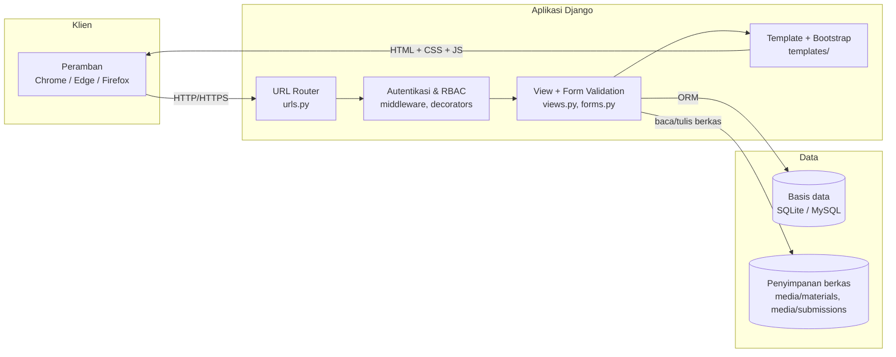
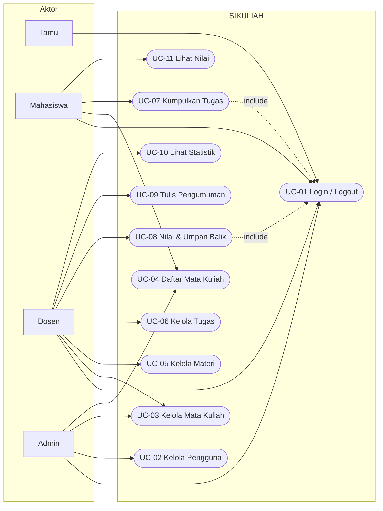
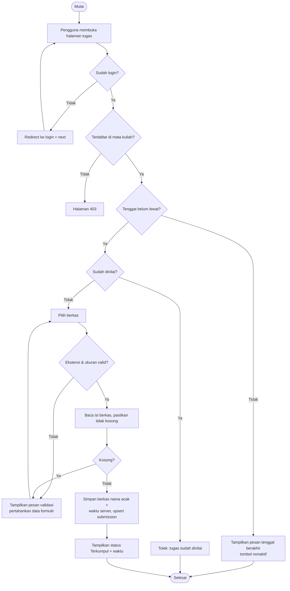
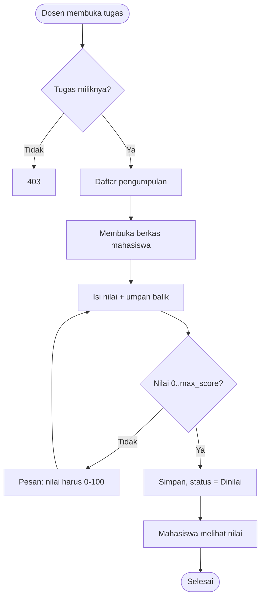
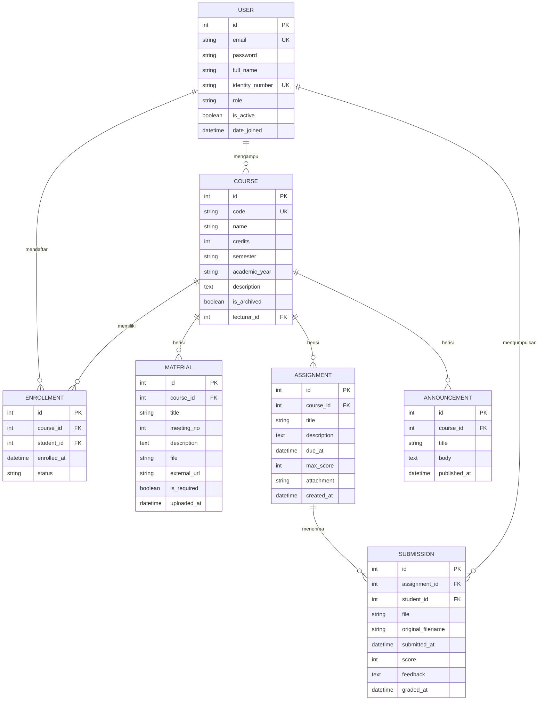
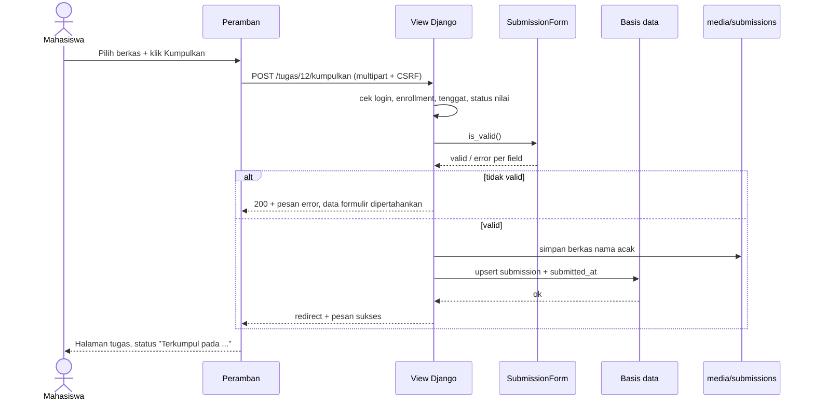
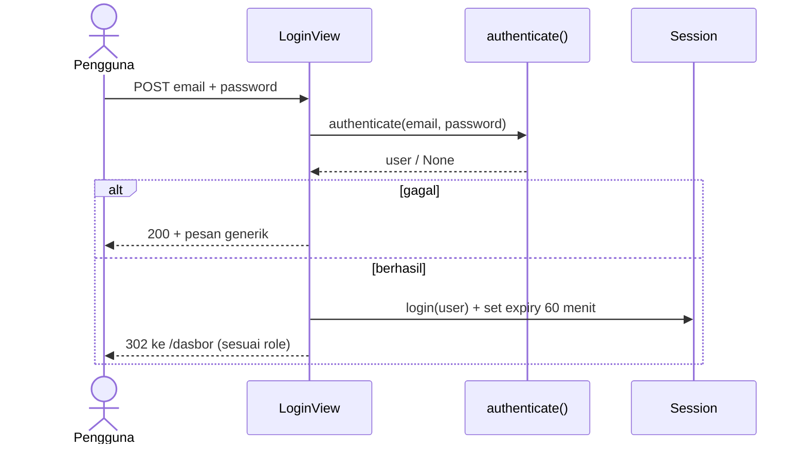
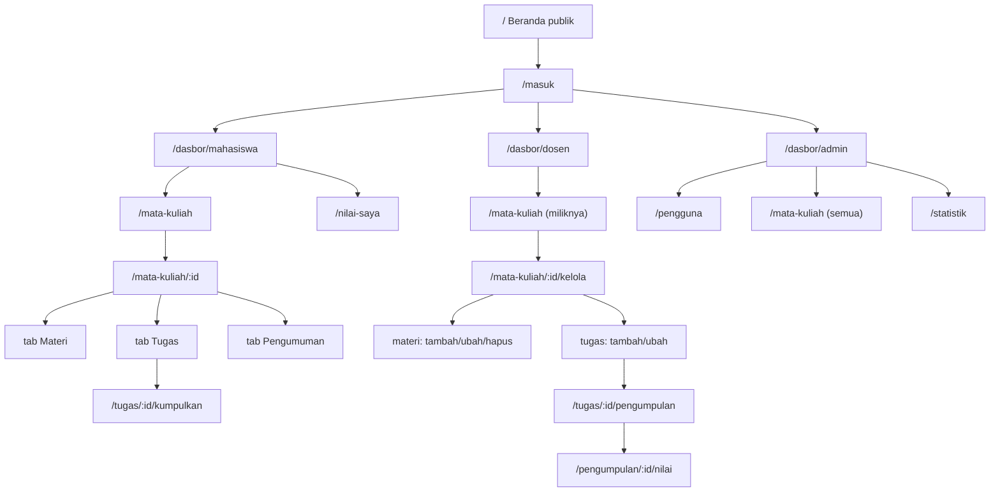

# 04 — Rancangan Sistem

Dokumen ini memuat seluruh diagram dan rancangan antarmuka yang diminta brief: use case,
flowchart, struktur data/basis data, arsitektur sistem, alur interaksi, dan wireframe.

> **Cara memakai:** diagram Mermaid di bawah dapat langsung dirender di GitHub/VS Code.
> Untuk PDF, ekspor setiap diagram ke PNG 2x (mermaid.live → Actions → PNG) dan simpan di
> `docs/build/img/` dengan nama `gambar-4-1-use-case.png`, dst.

---

## 1. Arsitektur sistem

Aplikasi memakai pola **MVT (Model–View–Template)** Django dengan tiga lapis logis.



| Lapis | Tanggung jawab | Bukti implementasi |
|-------|----------------|--------------------|
| Presentasi | Menampilkan halaman, formulir, pesan status | `templates/`, `static/` |
| Aplikasi | Routing, validasi, otorisasi, logika bisnis | `views.py`, `forms.py`, `decorators.py` |
| Data | Menyimpan entitas dan berkas | `models.py`, `migrations/`, `media/` |

Keputusan: **monolit Django** (bukan SPA + API terpisah) karena tim kecil, kebutuhan
render sisi server, dan validasi formulir bawaan Django mengurangi kode yang harus diuji.

---

## 2. Diagram use case



**Gambar 4.1 — Diagram use case SIKULIAH**

### 2.1 Use case descriptions (3 terpilih)

#### UC-01 — Login
| Bagian | Isi |
|--------|-----|
| Aktor | Tamu (semua peran) |
| Prakondisi | Akun terdaftar dan aktif |
| Pemicu | Pengguna membuka halaman terbatas atau menekan "Masuk" |
| Alur normal | 1. Sistem menampilkan formulir surel + kata sandi. 2. Pengguna mengisi dan mengirim. 3. Sistem memverifikasi kredensial dan status akun. 4. Sistem membuat sesi. 5. Sistem mengarahkan ke dasbor sesuai peran. |
| Alur alternatif | 3a. Kredensial salah → pesan generik, hitung percobaan. 3b. Akun nonaktif → pesan hubungi admin. |
| Pascakondisi | Sesi aktif; `last_login` diperbarui |
| Kebutuhan | FR-01, NFR-02, NFR-03 |

#### UC-05 — Kelola materi
| Bagian | Isi |
|--------|-----|
| Aktor | Dosen (utama), Admin (pemeliharaan) |
| Prakondisi | Login sebagai dosen pengampu mata kuliah |
| Alur normal | 1. Dosen membuka mata kuliah → tab Materi. 2. Menekan "Tambah materi". 3. Mengisi judul, pertemuan, deskripsi, memilih berkas **atau** tautan. 4. Sistem memvalidasi (wajib isi salah satu sumber; ekstensi; ukuran ≤ 5 MB). 5. Sistem menyimpan berkas dengan nama acak. 6. Materi tampil di daftar. |
| Alur alternatif | 4a. Ukuran > 5 MB → pesan "Ukuran maksimum 5 MB". 4b. Ekstensi tidak diizinkan → daftar format tampil. 4c. Dosen bukan pengampu → 403. |
| Pascakondisi | Materi tersimpan dan dapat diunduh peserta |
| Kebutuhan | FR-05, NFR-02 |

#### UC-07 — Kumpulkan tugas
| Bagian | Isi |
|--------|-----|
| Aktor | Mahasiswa terdaftar |
| Prakondisi | Tugas ada, mahasiswa peserta mata kuliah |
| Alur normal | 1. Mahasiswa membuka tugas. 2. Menekan "Kumpulkan". 3. Memilih berkas. 4. Sistem memeriksa login, keanggotaan, tenggat, ekstensi, ukuran, dan isi berkas. 5. Sistem menyimpan berkas + stempel waktu server. 6. Sistem menampilkan status "Terkumpul". |
| Alur alternatif | 4a. Lewat tenggat → "Tenggat telah berakhir" dan tombol dinonaktifkan. 4b. Berkas tidak valid → pesan spesifik. 4c. Sudah dinilai → unggahan ulang ditolak. |
| Pascakondisi | Tepat satu record pengumpulan per (tugas, mahasiswa) |
| Kebutuhan | FR-07, BR-02, BR-05 |

---

## 3. Alur proses (flowchart)

### 3.1 Flowchart pengumpulan tugas — proses inti



**Gambar 4.2 — Flowchart pengumpulan tugas (FR-07)**

### 3.2 Flowchart penilaian



**Gambar 4.3 — Flowchart penilaian tugas (FR-08)**

---

## 4. Struktur data dan basis data

### 4.1 ERD



**Gambar 4.4 — ERD SIKULIAH**

### 4.2 Kamus data

#### Tabel `users` (model `User`, extend `AbstractUser`)
| Field | Tipe | Aturan | Keterangan |
|-------|------|--------|------------|
| id | BigAutoField | PK | |
| email | EmailField | unik, wajib, dipakai untuk login | |
| password | CharField(128) | hash PBKDF2/Argon2 | Tidak pernah ditampilkan |
| full_name | CharField(120) | wajib | Nama tampilan |
| identity_number | CharField(20) | unik | NIM (mahasiswa) / NIDN (dosen) |
| role | CharField(10) | pilihan: `admin`, `dosen`, `mahasiswa` | Dasar RBAC |
| is_active | BooleanField | default True | Akun nonaktif tidak bisa login |
| date_joined | DateTimeField | otomatis | |

#### Tabel `courses`
| Field | Tipe | Aturan | Keterangan |
|-------|------|--------|------------|
| id | BigAutoField | PK | |
| code | CharField(10) | unik, uppercase | mis. `IF-301` |
| name | CharField(150) | wajib | |
| credits | PositiveSmallIntegerField | 1–6 | SKS |
| semester | CharField(10) | wajib | `Ganjil` / `Genap` |
| academic_year | CharField(9) | pola `2026/2027` | |
| description | TextField | opsional | |
| is_archived | BooleanField | default False | Arsip, bukan hapus |
| lecturer | ForeignKey(User) | `limit_choices_to role=dosen`, `PROTECT` | Satu dosen per MK (BR-01) |

#### Tabel `enrollments`
| Field | Tipe | Aturan | Keterangan |
|-------|------|--------|------------|
| course | ForeignKey(Course) | `CASCADE` | |
| student | ForeignKey(User) | `CASCADE`, role mahasiswa | |
| enrolled_at | DateTimeField | otomatis | |
| status | CharField(10) | `active` / `dropped` | |
| — | — | **unique_together (course, student)** | Cegah duplikat (AC-04.1) |

#### Tabel `materials`
| Field | Tipe | Aturan |
|-------|------|--------|
| course | ForeignKey(Course) | `CASCADE` |
| title | CharField(200) | wajib |
| meeting_no | PositiveSmallIntegerField | 1–16 |
| description | TextField | opsional |
| file | FileField(upload_to `materials/%Y/%m/`) | opsional jika `external_url` diisi |
| external_url | URLField | opsional jika `file` diisi |
| is_required | BooleanField | default False |
| uploaded_at | DateTimeField | otomatis |

Validasi: minimal salah satu dari `file`/`external_url`; ekstensi ∈ {pdf, docx, pptx, zip};
ukuran ≤ 5 MB.

#### Tabel `assignments`
| Field | Tipe | Aturan |
|-------|------|--------|
| course | ForeignKey(Course) | `CASCADE` |
| title | CharField(200) | wajib |
| description | TextField | wajib |
| due_at | DateTimeField | > `created_at` (BR-04) |
| max_score | PositiveSmallIntegerField | 1–100, default 100 |
| attachment | FileField | opsional |

#### Tabel `submissions`
| Field | Tipe | Aturan |
|-------|------|--------|
| assignment | ForeignKey(Assignment) | `CASCADE` |
| student | ForeignKey(User) | `CASCADE` |
| file | FileField(upload_to `submissions/%Y/%m/`) | wajib |
| original_filename | CharField(255) | nama asli untuk ditampilkan |
| submitted_at | DateTimeField | `timezone.now()` di server |
| score | PositiveSmallIntegerField, null | ≤ `assignment.max_score` |
| feedback | TextField, blank | |
| graded_at | DateTimeField, null | diisi saat dinilai |
| — | — | **unique_together (assignment, student)** (BR-02, AC-07.3) |

#### Tabel `announcements`
| Field | Tipe | Aturan |
|-------|------|--------|
| course | ForeignKey(Course) | `CASCADE` |
| title | CharField(200) | wajib |
| body | TextField | wajib, di-escape template |
| published_at | DateTimeField | otomatis, urut menurun |

### 4.3 Indeks dan performa
- Indeks pada `course.code`, `users.email`, `submissions(assignment, student)`.
- Query daftar menggunakan `select_related`/`prefetch_related` untuk menghindari N+1.
- Dasbor memakai agregasi `Count`/`Avg` di basis data, bukan loop di Python.

---

## 5. Alur interaksi (sequence diagram)

### 5.1 Pengumpulan tugas



**Gambar 4.5 — Sequence pengumpulan tugas**

### 5.2 Login dan RBAC



---

## 6. Rancangan antarmuka (wireframe)

Prinsip: navigasi atas tetap (logo · menu sesuai peran · nama pengguna), breadcrumb pada
halaman detail, satu aksi utama per halaman, status kosong yang menjelaskan langkah
berikutnya, dan warna status konsisten (hijau sukses, kuning peringatan, merah gagal).

### 6.1 Halaman login

```
┌──────────────────────────────────────────────────────────┐
│  SIKULIAH                                    [ Bantuan ] │
│                                                          │
│              ┌──────────────────────────────┐            │
│              │  Masuk ke SIKULIAH           │            │
│              │  Surel                       │            │
│              │  [________________________]  │            │
│              │  Kata sandi                  │            │
│              │  [________________________]  │            │
│              │  [        Masuk           ]  │            │
│              │  Lupa kata sandi?            │            │
│              │  ─────────────────────────   │            │
│              │  Belum punya akun? Daftar    │            │
│              └──────────────────────────────┘            │
└──────────────────────────────────────────────────────────┘
```

### 6.2 Dasbor dosen

```
┌──────────────────────────────────────────────────────────┐
│ SIKULIAH | Dasbor  Mata Kuliah  Statistik     Dosen ▾   │
├──────────────────────────────────────────────────────────┤
│ Selamat datang, [Nama Dosen]                             │
│ ┌────────────┐ ┌────────────┐ ┌────────────────────┐    │
│ │ 3          │ │ 12         │ │ 48 / 90            │    │
│ │ Mata kuliah│ │ Tugas aktif│ │ Pengumpulan (53%)  │    │
│ └────────────┘ └────────────┘ └────────────────────┘    │
│ Mata kuliah saya                         [+ Mata kuliah]│
│ ┌──────────────────────────────────────────────────────┐ │
│ │ IF-301  Rekayasa Perangkat Lunak   32 mhs   [Kelola]│ │
│ │ IF-302  Basis Data                 30 mhs   [Kelola]│ │
│ └──────────────────────────────────────────────────────┘ │
│ Tenggat terdekat                                         │
│ • IF-301 — Tugas 2 (50 pengumpulan) — 3 hari lagi        │
└──────────────────────────────────────────────────────────┘
```

### 6.3 Detail mata kuliah — tab materi (Fitur Utama 1)

```
┌──────────────────────────────────────────────────────────┐
│ Dasbor / IF-301 Rekayasa Perangkat Lunak                 │
├──────────────────────────────────────────────────────────┤
│ [Materi] [Tugas] [Pengumuman] [Peserta]                  │
│ Materi                          [+ Tambah materi]        │
│ ┌──────────────────────────────────────────────────────┐ │
│ │ Pertemuan 5 · Wajib                                  │ │
│ │ Pemodelan Use Case            [Unduh] [Ubah] [Hapus] │ │
│ │ PDF · 1,2 MB · diunggah 12/10/2025                   │ │
│ ├──────────────────────────────────────────────────────┤ │
│ │ Pertemuan 6                                           │ │
│ │ Studi Kasus SRS               [Unduh] [Ubah]         │ │
│ │ Tautan eksternal                                     │ │
│ └──────────────────────────────────────────────────────┘ │
└──────────────────────────────────────────────────────────┘
```

### 6.4 Halaman tugas mahasiswa — pengumpulan (Fitur Utama 2)

```
┌──────────────────────────────────────────────────────────┐
│ Dasbor / IF-301 / Tugas 2 — Analisis Kebutuhan           │
├──────────────────────────────────────────────────────────┤
│ Tenggat: 20/10/2025 23.59  (2 hari lagi)                 │
│ Nilai maksimum: 100                                      │
│                                                          │
│ Deskripsi                                                │
│ Susun SRS untuk studi kasus kelompok...                  │
│                                                          │
│ Status: ● Terkumpul pada 18/10/2025 20.14                │
│ Berkas: srs_kelompok3.pdf (820 KB)      [Lihat]          │
│                                                          │
│ Unggah pengganti (sebelum dinilai)                       │
│ [ Pilih berkas ]  tidak ada berkas dipilih               │
│ PDF/DOCX/ZIP, maks. 5 MB                                 │
│ [ Kumpulkan ]                                            │
│                                                          │
│ Nilai: — (belum dinilai)                                 │
└──────────────────────────────────────────────────────────┘
```

### 6.5 Halaman penilaian dosen

```
┌──────────────────────────────────────────────────────────┐
│ Dasbor / IF-301 / Tugas 2 / Pengumpulan                  │
├──────────────────────────────────────────────────────────┤
│ 32 peserta · 28 terkumpul · 10 dinilai · rata-rata 78,4  │
│ Cari mahasiswa: [______________]                         │
│ ┌──────────────────────────────────────────────────────┐ │
│ │ Nama           Waktu unggah     Berkas   Nilai  Aksi │ │
│ │ Ani Lestari    18/10 20.14      [PDF]    85     [Ubah]│ │
│ │ Budi Santoso   19/10 09.02      [PDF]    —      [Nilai]│ │
│ │ Citra Dewi     — (belum)        —        —      —     │ │
│ └──────────────────────────────────────────────────────┘ │
└──────────────────────────────────────────────────────────┘
```

### 6.6 Keadaan khusus yang wajib dirancang
| Keadaan | Tampilan |
|---------|----------|
| Daftar kosong | Ikon + "Belum ada materi. Tambahkan materi pertama." + tombol aksi |
| Pencarian kosong | "Tidak ada hasil untuk 'kata kunci'. Coba kata lain." |
| Error validasi | Pesan di bawah field, border merah, ringkasan di atas formulir |
| 403 | "Anda tidak memiliki akses ke halaman ini." + tombol kembali ke dasbor |
| 404 | "Halaman tidak ditemukan." + tautan beranda |
| 500 | "Terjadi kesalahan pada server." + kode referensi + tautan beranda |
| Tenggat lewat | Tombol nonaktif + label "Tenggat telah berakhir" |

---

## 7. Sitemap dan navigasi



**Gambar 4.6 — Struktur navigasi halaman**

Aturan navigasi: maksimum 3 klik dari dasbor ke aksi utama; setiap halaman detail memiliki
breadcrumb; menu yang tidak relevan dengan peran tidak dirender (dan tetap diblokir di
server bila URL ditebak).

---

## 8. Spesifikasi antarmuka pengguna

| Aspek | Keputusan |
|-------|-----------|
| Framework CSS | Bootstrap 5.3 (tanpa build step) + satu `custom.css` |
| Warna primer | `#1E293B` (slate-800) — header, tombol utama |
| Warna aksen | `#F59E0B` (amber-500) — tenggat, sorotan |
| Warna status | sukses `#16A34A`, peringatan `#CA8A04`, bahaya `#DC2626`, info `#0284C7` |
| Latar | `#F8FAFC` dengan kartu putih, radius 12 px |
| Tipografi | `Inter`, fallback `system-ui`; judul 24/20 px, isi 16 px, meta 14 px |
| Ikon | Tidak memakai ikon font; status memakai badge dan warna (mengurangi dependensi) |
| Breakpoint | ≥ 992 px dua kolom; 768–991 px satu kolom; < 576 px tombol penuh lebar |
| Komponen wajib | navbar, breadcrumb, kartu statistik, tabel responsif, badge status, alert, halaman konfirmasi hapus, paginasi |
| Pola form | label di atas field, tanda `*` untuk wajib, teks bantuan di bawah field, ringkasan error di atas |
| Umpan balik | toast/alert setelah simpan; spinner pada tombol saat unggah |

---

## 9. Keterkaitan dengan kebutuhan

| Rancangan | Mencakup |
|-----------|----------|
| Gambar 4.1 | FR-01 … FR-10 (aktor & use case) |
| Gambar 4.2, 4.5 | FR-07, FR-06, BR-02, BR-05 |
| Gambar 4.3 | FR-08, BR-03 |
| Gambar 4.4, §4.2 | FR-02, FR-03, FR-04, FR-05, FR-09 |
| §6 wireframe | NFR-04, NFR-05, NFR-08, NFR-09 |
| §1 arsitektur | NFR-02, NFR-07, NFR-10 |
